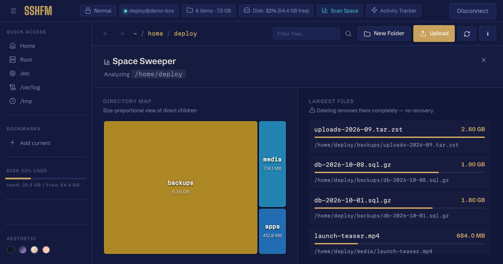
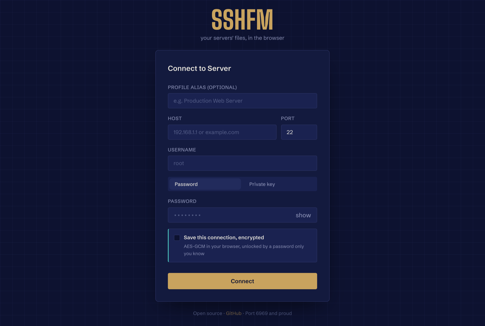

<p align="center"></p>

# sshfm

**A file manager for your servers, in the browser.** Connect over SSH, then browse, move, upload and download files,
and see what's eating the disk. No desktop client, nothing to install on the server.

**[Try the live demo →](https://shubhamxb.github.io/sshfm/)** a pretend server in your browser tab; nothing to sign up for, nothing leaves the page.

I built it because SFTP clients are either heavy desktop apps or a terminal, and most of the time you just want to look
at a server's files the way you'd look at your own.

<p align="center"></p>

## What it does

- **Files:** browse, upload, download, rename, make folders, with a transfer queue for the big ones
- **Disk usage:** a space analyzer that shows which folders are actually filling the disk
- **Saved connections, encrypted:** connection details live in a vault in your browser, encrypted with AES-GCM under a
  key derived from your password (PBKDF2, SHA-256, 100,000 rounds, random salt and IV per save). Nothing is stored
  server-side, and nothing is readable without the password
- **Activity log:** every action in a session, listed as it happens
- **Session at a glance:** host, user, mode and file permissions while you work

## Try it without a server

The [live demo](https://shubhamxb.github.io/sshfm/) is this. `npm run build:demo --prefix frontend` builds a demo: the same app, answered by a pretend server that lives in the
browser tab (`frontend/src/demo/api.js`). Browse, upload, rename, sudo into `/root`, scan the disk; nothing opens a
connection, and a reload resets it. The output in `frontend/dist-demo/` is static and works from any path.

## Run it

**Docker** (recommended):

```sh
cp backend/.env.example backend/.env    # defaults are fine; nothing secret goes in here
docker compose up --build               # → http://localhost:6969
```

**Without Docker** (Node 20+):

```sh
npm run install:all
npm run dev                             # backend + frontend together
```

The container has a health check (`/api/health`). Put it behind your own reverse proxy and auth if it faces the
internet: whoever can reach sshfm can try to open SSH sessions from it.

<p align="center"></p>

## How it's built

| | |
|---|---|
| frontend | Vue 3 + Vite: file manager, space analyzer, transfer queue, the vault (Web Crypto) |
| backend | Express 5 + [`ssh2`](https://github.com/mscdex/ssh2) for SSH and SFTP |
| deploy | one Docker image, `docker compose`, health-checked |

More in [`docs/DEVELOPMENT.md`](docs/DEVELOPMENT.md). Icons: [Lucide](https://lucide.dev) (ISC). Type: Big Shoulders
Display, Schibsted Grotesk and Martian Mono (SIL Open Font License).

## Status

The core works: connect, browse, transfer, analyze. The UI is still being polished; issues and ideas are welcome.

Built by [Shubham Bhagwat](https://shubhamxb.github.io): I build systems that run themselves.
